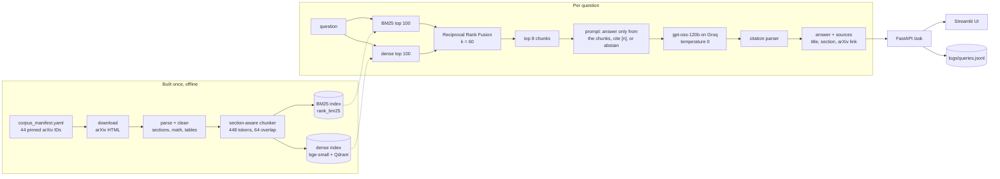

# PaperRAG

**An evaluated retrieval-augmented question-answering system over 44 AI/ML research papers.**


Answers cite the exact passages they rely on, and when the papers don't contain the answer the
system says *"I couldn't find sufficient evidence in the available sources."* instead of
guessing.

The project is an evaluated retrieval system, not a chatbot: four retrieval setups were compared
on a question set fixed before any tuning, the best one was frozen on the dev split, and it was
run **once** on a held-out test split. Everything is plain Python (no LangChain or LlamaIndex),
runs on a laptop CPU, and uses free-tier models only.

## Results

### Setup comparison (dev)

37 dev questions (30 answerable, 7 unanswerable), used for every tuning decision. Each setup's
top 8 chunks were sent to the same generator. Retrieval metrics are over the 30 answerable
questions, top 10 chunks per setup. Sources: [reports/retrieval.md](reports/retrieval.md),
[reports/generation.md](reports/generation.md).

| Retrieval setup | Recall@3 | Recall@5 | Recall@10 | MRR | nDCG@10 | Abstention accuracy | Faithfulness | Citation correctness \* | Relevance | Correctness \* | Retrieval p50 |
|---|---|---|---|---|---|---|---|---|---|---|---|
| BM25 | 0.494 | 0.517 | 0.656 | 0.499 | 0.443 | 0.892 | 0.929 | 0.786 | 1.000 | 0.593 | 8 ms |
| Dense | 0.444 | 0.517 | 0.644 | 0.400 | 0.362 | 0.892 | 0.923 | 0.731 | 1.000 | 0.654 | 23 ms |
| Hybrid (RRF) | 0.511 | 0.611 | 0.772 | 0.533 | 0.486 | 0.919 | 0.931 | 0.759 | 1.000 | 0.679 | 32 ms |
| Hybrid + reranker | 0.517 | 0.594 | 0.678 | 0.501 | 0.449 | 0.919 | 0.931 | 0.724 | 0.966 | 0.679 | 1375 ms |

Plain hybrid (BM25 + dense, Reciprocal Rank Fusion) was chosen on dev and frozen.

### Final system on the held-out test set

36 test questions (29 answerable, 7 unanswerable), run once on the frozen system. Brackets:
95% bootstrap intervals over questions. Judge metrics cover the 24 answerable questions the
system answered (abstentions have no claims to judge). Source:
[reports/generation_test.md](reports/generation_test.md); test retrieval for all four setups:
[reports/retrieval_test.md](reports/retrieval_test.md).

| System | Recall@3 | Recall@5 | Recall@10 | MRR | nDCG@10 | Abstention accuracy | Faithfulness | Citation correctness \* | Relevance | Correctness \* |
|---|---|---|---|---|---|---|---|---|---|---|
| Hybrid (RRF), top 8, gpt-oss-120b | 0.356 [0.21, 0.51] | 0.489 [0.33, 0.64] | 0.655 [0.49, 0.80] | 0.438 [0.30, 0.60] | 0.389 [0.28, 0.50] | 0.861 [0.75, 0.97] | 0.958 [0.88, 1.00] | 0.792 [0.62, 0.96] | 1.000 [1.00, 1.00] | 0.625 [0.42, 0.83] |

Latency p50 on a laptop CPU: retrieval 37 ms, generation 772 ms (the API call). Cost: $0
(free tiers).

\* **Indicative only:** the LLM judge's agreement with the reference grades on these two
metrics is below the threshold set in advance (see [Evaluation](#evaluation)).

**Reading the retrieval numbers:** relevance is strict. A chunk counts only if it contains the
gold quote or an approved alternative wording, so passages that state the same fact differently
count as misses; a check on dev found this in 10 of 15 misses. The corpus is dense technical
text with LaTeX, where similar papers compete. For reference, BM25 averages roughly 0.4
nDCG@10 on the BEIR benchmark (Thakur et al., 2021).

## Key findings

1. **Retrieval is the bottleneck, not generation.** Of the 16 test answers with any flagged
   outcome, 10 trace back to the gold evidence missing from the top 8 chunks, 1 to generation,
   and 5 to judge strictness on correct answers
   ([error analysis](reports/error_analysis.md)).
2. **The generator abstains when it should and stays grounded when it answers.** All 7
   unanswerable test questions were refused with the exact abstention sentence, and each of the
   5 false abstentions on answerable test questions happened with no gold evidence in the
   context. Faithfulness is 0.958 on test: the one unfaithful answer (q212) was
   retrieval-induced, since all 8 chunks came from one of the two papers asked about and the
   model filled the gap from memory. On partial evidence, the model answers the covered half
   and says what the context does not cover.
3. **Hybrid won on dev; on test the reranker and BM25 looked better; none of it is
   significant.** On dev, the cross-encoder reranker was slightly below plain hybrid; on test it
   is above on every retrieval metric, and BM25 is above hybrid on Recall@5. Every paired
   interval includes 0 on both splits, as expected from two ~30-question samples around small
   true differences. BM25 is a strong baseline here because technical questions share rare
   terms with their evidence (model names, numbers). The system was frozen on dev before the
   test run, so it stays plain hybrid; the reranker would also cost about 1.4 s per query on
   CPU, and adopting it would need a new held-out set.
4. **An LLM judge has to be measured.** The judge agreed perfectly with the reference grades on
   faithfulness and relevance, but only moderately on citation correctness (κ 0.52) and
   correctness (κ 0.46). It counts "the context does not cover X" sentences as uncited claims
   and marks correct answers 0 for a minor omission, so correctness (0.625) understates
   complete answers.

## How it works



- **Parsing:** arXiv's own HTML at a pinned version (no PDF), which keeps section structure
  and LaTeX math. References are removed; tables become text.
- **Chunking:** chunks never cross a section boundary, and are sized with the embedding model's
  own tokenizer, so every embedded sequence fits its 512-token window (a build check verifies
  it). BM25 indexes the full title and section path with each chunk; the dense model gets a
  short header capped at 32 tokens, because every header token is taken from the chunk's
  budget.
- **Hybrid retrieval:** BM25 and dense rankings are fused by rank only (Reciprocal Rank Fusion,
  k = 60, Cormack et al. 2009), so their incompatible score scales never meet and there is
  nothing to tune.
- **Generation:** the prompt numbers the 8 chunks, asks for an answer supported only by them
  with `[n]` citations, and requires the exact abstention sentence when the evidence is
  insufficient. The parser maps each `[n]` (also gpt-oss's native `【n】` and `【n†…】` forms)
  to the chunk's paper title, section and a link to that section on arXiv.
- **Serving:** the API serves exactly the evaluated configuration; it refuses to start if
  `configs/default.yaml` differs from it, and `/ask` takes no options. A parity test checks
  that it reproduces every evaluated dev answer.

## Evaluation

- **Questions:** 73 questions, written and fixed before any retrieval tuning, following the
  rules in [eval/README.md](eval/README.md): 42 factual, 17 comparison across papers, 14
  unanswerable, split once, by type, into dev (37) and test (36). Each answerable question
  stores its evidence as paper + short verbatim quote, not chunk IDs, so the set survives
  changes in chunking.
- **Relevance:** a retrieved chunk is relevant if it contains a gold quote or an approved
  alternative wording of the same fact.
- **Retrieval metrics:** Recall@k (share of a question's evidence items found in the top k),
  MRR and nDCG@10, with 95% bootstrap intervals over questions (1,000 resamples, seed 42) and
  paired bootstrap for differences between setups.
- **Generation metrics:** an LLM judge (`qwen/qwen3.8-27b`, a different model family from the
  generator) labels each answer for faithfulness (every claim supported by the chunks),
  citation correctness (each cited chunk supports its claim), relevance and correctness against
  the reference answer. Abstention accuracy is scored by rule.
- **Judge validation:** the judge was checked against reference grades for 20 dev answers,
  fixed before its labels were seen; the acceptance rule was set in advance: Cohen's κ ≥ 0.6
  (raw agreement ≥ 0.85 for metrics where one label dominates). 19 answers were gradeable (one
  was an abstention). A first judge (Gemini 3.5 Flash-Lite) failed the rule; the predefined
  fallback, qwen, was kept ([reports/results/judge_validation.json](reports/results/judge_validation.json)):

  | Metric | κ | Raw agreement | Status |
  |---|---|---|---|
  | Faithfulness | 1.00 | 1.00 | reliable |
  | Relevance | undefined (one label) | 1.00 | reliable |
  | Citation correctness | 0.52 | 0.79 | indicative only |
  | Correctness | 0.46 | 0.79 | indicative only |

- **One test run:** the code, configs and evaluation files were frozen at a recorded commit,
  the test commands refuse to run without an explicit flag, and nothing was changed or re-run
  on test after the results were seen.
- **Error analysis:** 13 failures from test and dev, sorted into retrieval miss, reranker
  drop, hallucination and wrong abstention, each checked against the chunk text:
  [reports/error_analysis.md](reports/error_analysis.md).

## Run it (Windows PowerShell)

Quick start, with Python 3.11 and a free [Groq API key](https://console.groq.com/keys):

```powershell
py -3.11 -m venv .venv; .\.venv\Scripts\Activate.ps1
python -m pip install -e ".[dev]"
Copy-Item .env.example .env                  # put your GROQ_API_KEY in .env (never committed)
python -m ragpapers.ingest.download; python -m ragpapers.ingest.parse; python -m ragpapers.chunking.build
uvicorn ragpapers.api.app:app --port 8000    # API, docs at http://localhost:8000/docs
streamlit run src/ragpapers/ui/app.py        # UI at http://localhost:8501 (second terminal)
```

<details>
<summary><b>All commands: setup, corpus, evaluation, serving, Docker, checks</b></summary>

**Setup.** `py -0p` lists the installed Python versions.

```powershell
cd C:\path\to\ml-papers-rag
py -3.11 -m venv .venv
.\.venv\Scripts\Activate.ps1
python -m pip install --upgrade pip
python -m pip install -e ".[dev]"
pre-commit install
Copy-Item .env.example .env   # then put your GROQ_API_KEY in .env (never committed)
```

If `Activate.ps1` is blocked, run once: `Set-ExecutionPolicy -Scope CurrentUser RemoteSigned`.

**Rebuild the corpus and indexes.** The raw data is not committed; the manifest pins every
paper's arXiv version, so anyone gets the same corpus.

```powershell
python -m ragpapers.ingest.download   # 44 papers from arXiv HTML (one request every 3 s)
python -m ragpapers.ingest.parse      # data/processed/: sections, text, math, tables
python -m ragpapers.ingest.stats      # reports/corpus_stats.json
python -m ragpapers.chunking.build    # data/chunks/ + token-budget and quote checks
```

**Ask a question from the command line, or reproduce the evaluation.** LLM responses are cached
on disk, so re-running an experiment costs no API calls and gives identical answers. Commands
that call an LLM only estimate the token use unless given `--run`.

```powershell
python -m ragpapers.generation.answer "Which weights does LoRA keep frozen?"
python -m ragpapers.evaluation.evaluate_retrieval            # builds the indexes (embedding takes a few minutes on CPU) + dev retrieval table
python -m ragpapers.evaluation.run_generation --setup hybrid --run
python -m ragpapers.evaluation.judge --setup hybrid --run
python -m ragpapers.evaluation.evaluate_generation           # dev generation table
python -m ragpapers.evaluation.agreement                     # judge vs reference grades
```

**Serve it.** The API loads the indexes once and runs one warm-up retrieval at startup.

```powershell
uvicorn ragpapers.api.app:app --port 8000      # API, docs at http://localhost:8000/docs
streamlit run src/ragpapers/ui/app.py          # UI at http://localhost:8501 (second terminal)
```

- `POST /ask` with `{"question": "..."}` returns the answer, its citations, the 8 retrieved
  chunks with their RRF scores and BM25 / dense ranks, and the latencies. `GET /health`
  reports what is loaded, without calling the LLM.
- Every request is appended to `logs/queries.jsonl` (gitignored): question, retrieved chunk
  IDs, scores, citations and latencies.

**Or with Docker Desktop**, after building the corpus and indexes on the host (they are mounted
into the containers, not copied into the image):

```powershell
docker compose up --build    # API on :8000, UI on :8501
```

Embedded Qdrant allows one process at a time, so stop a local API before starting the
containers, and the other way round.

**Checks:**

```powershell
ruff check .
ruff format --check .
pytest                 # offline: no network, no API keys needed
pytest -m parity       # local data only: the API reproduces every evaluated dev answer from the cache
```

</details>

## Limitations

- **Small evaluation set.** 73 questions, 29 answerable on test: intervals are wide (about
  ±0.15 on recall), so only large differences between setups could be detected.
- **Judge bias and scoring rules.** Citation correctness and correctness come from an LLM judge
  whose agreement with the reference grades is below the threshold set in advance; they are
  indicative only. The reference grades are a small sample (19 answers), not independent
  expert annotations. The exact-sentence abstention rule also scores a faithful rejection of a
  false premise (dev q215) as an error.
- **Parsing loses structure.** Tables are flattened to text, figures keep only their
  captions, and equations stay as LaTeX source. The UI renders that math with KaTeX; about 1% of
  formulas (unsupported commands, or formulas cut at a chunk boundary) are shown as plain text.
- **Retrieval misses dominate the errors**, especially on comparison questions, where all 8
  chunks can come from one of the papers asked about. The final top-8 context has a dev
  Recall@8 of 0.72.
- **Free tiers and scale.** Generation and judging depend on Groq's free quotas (a full dev run
  uses about 137K of the generator's 200K daily tokens), and free-tier model lists change
  (Llama models left Groq's free tier in August 2026, hence gpt-oss-120b). Temperature 0 does
  not guarantee identical replies across API calls, so results are reproduced from the response
  cache. The corpus is a fixed set of 44 English papers, everything runs on CPU, and embedded
  Qdrant allows one process, so the API answers one request at a time: a laptop demo, not a
  service for concurrent users.

## Why no framework

LangChain and LlamaIndex were left out on purpose. The point of the project is to see, and to
measure, every step: how a paper becomes chunks, how two rankings are fused, exactly what text
the model receives, how citations are parsed, and what each stage costs in latency. In plain
Python each of those is a short function with tests (RRF is a few lines; the prompt is one
file), every parameter lives in `configs/default.yaml`, and an evaluation changes exactly one
thing at a time. A framework would hide those steps behind abstractions and add dependencies
whose defaults (chunking, prompts, retries) would become part of the results without being
visible in them.

## Models (free tiers only)

| Role | Model | Free-tier limits (per model) |
|---|---|---|
| Embeddings | `BAAI/bge-small-en-v1.5` (local, CPU) | none |
| Reranker (evaluated, not used) | `cross-encoder/ms-marco-MiniLM-L-6-v2` (local, CPU) | none |
| Generator | `openai/gpt-oss-120b` on Groq, top 8 plain-hybrid chunks, temperature 0 | 30 RPM, 1K RPD, 8K TPM, 200K TPD |
| Judge (evaluation only) | `qwen/qwen3.8-27b` on Groq | 30 RPM, 1K RPD, 8K TPM, 200K TPD |

Limits as listed on the free-tier consoles in October 2026; they change, so check yours.

## Repository layout

```
configs/default.yaml        every parameter: chunking, retrieval, models, limits, paths
data/corpus_manifest.yaml   the 44 papers (arXiv ID, version, title, year, topic)
eval/                       questions, dev/test split, judge sample, reference grades
src/ragpapers/
  ingest/                   download, parse, clean
  chunking/                 section-aware, token-sized chunker
  index/                    BM25, embeddings + Qdrant
  retrieval/                pipeline, Reciprocal Rank Fusion, reranker
  generation/               prompt, citation parser, LLM client (cache, throttle, retries)
  evaluation/               metrics, judge, agreement, experiment runners, test-run freeze
  api/                      FastAPI service, frozen-config guard, query log
  ui/                       Streamlit page
reports/                    generated tables, error analysis, results/ (configs + metrics per run)
tests/                      offline test suite (CI on every pull request)
```
